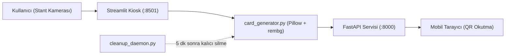

# ⚡ Altınbaş AI Club — Stant Kart Üretim & Mobil İndirme Sistemi

Altınbaş Üniversitesi Yapay Zeka Kulübü tanıtım stantları için geliştirilmiş, ziyaretçilere anlık olarak kişiselleştirilmiş **AI Muse Edition** veya **Player Edition (FUT)** dijital kartı üreten ve QR kod ile telefonlarına indirmelerini sağlayan tam teşekküllü kiosk uygulamasıdır.

---

## 🌟 Öne Çıkan Özellikler

- **📱 9:16 Instagram Story Formatı (1080×1920):** Doğrudan sosyal medyada paylaşılmaya hazır yüksek çözünürlüklü dikey çıktı.
- **🎨 Çift Tema Desteği:**
  - **Muse Edition:** Yaratıcı ve estetik odaklı, Montserrat ExtraBold tipografisiyle lüks/moda dergisi kimliği.
  - **Player Edition:** EA FC / FUT tarzı, Bebas Neue tipografisiyle enerjik ve dinamik spor kartı kimliği.
- **🪄 Otomatik Arka Plan Ayrıştırma (`rembg`):** Stant ortamındaki kalabalık arka planı izole eder, yumuşak neon aura ve derinlik efektleri ekler.
- **🔒 KVKK & Veri Gizliliği (Zero-Retention):**
  - **128-Bit Kriptografik Token:** Her kart `secrets.token_hex(16)` ile tahmin edilemez 32 karakterlik güvenli bir ID ile üretilir.
  - **5 Dakika TTL (Otomatik İmha):** Kart ve ham çekim fotoğrafları üretildikten 5 dakika sonra arka plan temizlik servisi (`cleanup_daemon.py`) tarafından kalıcı olarak silinir.
  - **Güvenli Servis:** Doğrudan statik dizin erişimi kapalıdır; tüm indirmeler süre ve token kontrolünden geçer (`Cache-Control: no-store`).
- **📶 Akıllı Yerel Ağ Çözümleme:** İnternet erişimi olmasa dahi yerel stant ağını veya telefon bağlantı noktasını (Hotspot) otomatik tespit ederek mobil uyumlu QR kod oluşturur.

---

## 🏛️ Mimari ve Servisler

Sistem tek komutla eşzamanlı çalışan iki servisten oluşur:



1. **Streamlit Arayüzü (`:8501`):** Stant görevlileri ve ziyaretçiler için çekim, isim, bölüm seçimi ve önizleme ekranı.
2. **FastAPI Sunucusu (`:8000`):** QR indirme sayfası, kart servis ucu ve sistem sağlık kontrolü (`/health`).
3. **Temizlik Daemon'u:** Arka planda 20 saniyede bir çalışarak süresi dolan dosyaları bellekten ve diskten temizler.

---

## 🚀 Hızlı Başlangıç

### 1. Gereksinimler
- Python 3.10 veya üzeri
- Web kamerası (Dahili veya USB)

### 2. Kurulum

```bash
# Proje dizinine geçin
cd ai_club_stand

# Gerekli kütüphaneleri yükleyin
pip install -r requirements.txt
```

### 3. Tek Komutla Çalıştırma

Tüm servisleri (FastAPI + Streamlit + Temizlik Daemon'u) tek seferde başlatmak için:

```bash
python run_stand.py
```

Başlatıldıktan sonra tarayıcınızda otomatik olarak açılır:
- **Kiosk Arayüzü:** `http://localhost:8501`
- **İndirme API & Sağlık:** `http://localhost:8000/health`

---

## 🌐 Canlıya Alma ve Mobil İndirme Seçenekleri

### 🥇 1. Seçenek: Cloudflare Tunnel (Tavsiye Edilen — Sıfır Sürtünme)
Sistem başlatıldığında otomatik olarak Cloudflare Quick Tunnel açar (`https://*.trycloudflare.com`).
- **Üniversite Wi-Fi İzolasyonunu Aşar:** Öğrencilerin stant Wi-Fi'ına bağlanmasına gerek kalmaz.
- **Kendi Mobil Verisiyle İndirme:** Ziyaretçi kendi 4.5G/5G internetiyle QR'ı taratır ve saniyeler içinde kartını indirir.
- **Tamamen Ücretsiz & HTTPS:** Doğrudan SSL sertifikalı güvenli bağlantı sağlar.

```bash
# Otomatik Cloudflare Tüneli ile başlatma:
python run_stand.py

# (Opsiyonel) Tünelsiz, sadece yerel ağda çalıştırmak isterseniz:
python run_stand.py --no-tunnel
```

---

## 📶 Stant Günü Ağ & Wi-Fi Rehberi (İnternetsiz / Offline B Planı)

Eğer stant alanında mobil veri çekmiyorsa veya internet bağlantısı kesilirse:

### A. Telefon Bağlantı Noktası (Hotspot) ile Kullanım
1. Telefonunuzdan **Kişisel Erişim Noktası / Hotspot** açın.
2. Stant dizüstü bilgisayarını bu ağa bağlayın.
3. Sistemi `--no-tunnel` ile çalıştırdığınızda `network_utils.py` otomatik olarak Hotspot IP'sini (`192.168.43.x` vb.) tespit eder ve QR kodları bu IP üzerinden üretir.

### B. Manuel IP Sabitleme
Eğer bilgisayarda birden fazla ağ kartı (Ethernet, Sanal Ağlar, VPN) varsa, QR kodun doğru IP ile basılması için terminalde IP belirtebilirsiniz:

```bash
# Windows PowerShell:
$env:STAND_IP="192.168.1.100"
python run_stand.py

# Linux / macOS:
export STAND_IP="192.168.1.100"
python run_stand.py
```

### C. Windows Güvenlik Duvarı İzni
Ziyaretçilerin telefonundan bağlantı hatası almaması için Windows Güvenlik Duvarı'nda Python'a yerel ağ erişim izni verildiğinden emin olun. Gerekirse PowerShell (Yönetici) ile:

```powershell
New-NetFirewallRule -DisplayName "AI Club Stand Kiosk" -Direction Inbound -LocalPort 8000,8501 -Protocol TCP -Action Allow
```

---

## 📂 Proje Dizin Yapısı

```text
ai_club_stand/
├── .streamlit/
│   └── config.toml           # Streamlit sunucu ve headless ayarları
├── assets/
│   ├── fonts/                # Montserrat-Bold.ttf & BebasNeue-Regular.ttf (SIL OFL)
│   └── frames/               # frame_muse.jpg & frame_apex.jpg (Temiz şablonlar)
├── static/
│   ├── cards/                # 128-bit token ile üretilen kartlar (.gitignore korumalı)
│   └── snaps/                # Oturum fotoğrafları (.gitignore korumalı)
├── app.py                    # Streamlit stant kullanıcı arayüzü
├── card_generator.py         # Pillow & rembg ile 1080x1920 kompozisyon motoru
├── download_server.py        # FastAPI mobil indirme ve görsel servis ucu
├── cleanup_daemon.py         # 5 dakikalık KVKK temizlik servisi
├── network_utils.py          # Yerel stant IP ve genel tünel çözümleyici
├── tunnel_manager.py         # Cloudflare Quick Tunnel otomatik yöneticisi
├── rehearsal_test.py         # 20 kartlık prova ve stres testi
├── run_stand.py              # Eşzamanlı başlatıcı yönetici (API + Tunnel + UI)
├── requirements.txt          # Python paket bağımlılıkları
├── .gitignore                # Güvenlik ve gizlilik filtresi
└── README.md                 # Proje dokümantasyonu
```

---

## 🧪 Stres ve Dayanıklılık Testi

Stant açılmadan önce sistemin hızını ve hata vermediğini doğrulamak için prova script'ini çalıştırabilirsiniz:

```bash
python rehearsal_test.py
```
*(20 kartlık ardışık üretim gerçekleştirir ve ortalama kart üretim süresini raporlar.)*

---

## 📄 Lisans & Telif

- Tipografi dosyaları ([Montserrat](https://fonts.google.com/specimen/Montserrat), [Bebas Neue](https://fonts.google.com/specimen/Bebas+Neue)) **SIL Open Font License (OFL)** kapsamındadır.
- Bu proje **Altınbaş Üniversitesi Yapay Zeka Kulübü** etkinlikleri için geliştirilmiştir.
