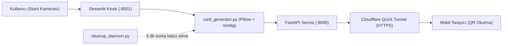

# ⚡ Altınbaş AI Club — Stant Kart Üretim & Mobil İndirme Sistemi

Altınbaş AI Club tanıtım stantları için geliştirilmiş, ziyaretçilere anlık olarak kişiselleştirilmiş **AI Muse Edition** veya **Player Edition (FUT)** dijital kartı üreten ve QR kod ile telefonlarına indirmelerini sağlayan tam teşekküllü kiosk uygulamasıdır.

---

## 🌟 Öne Çıkan Özellikler

- **📱 9:16 Instagram Story Formatı (1080×1920):** Doğrudan sosyal medyada paylaşılmaya hazır yüksek çözünürlüklü dikey çıktı.
- **🎨 Çift Tema Desteği:**
  - **Muse Edition:** Yaratıcı ve estetik odaklı, Montserrat ExtraBold tipografisiyle lüks/moda dergisi kimliği.
  - **Player Edition:** EA FC / FUT tarzı, Bebas Neue tipografisiyle enerjik ve dinamik spor kartı kimliği.
- **🪄 Otomatik Arka Plan Ayrıştırma (`rembg`):** Stant ortamındaki kalabalık arka planı izole eder, yumuşak neon aura ve derinlik efektleri ekler.
- **🌐 Dahili Cloudflare Quick Tunnel:** Üniversite Wi-Fi'ındaki cihaz izolasyonunu (AP isolation) aşar; ziyaretçiler kendi 4.5G/5G mobil verileriyle QR'ı taratıp kartı anında indirebilir.
- **🔒 KVKK & Veri Gizliliği (Zero-Retention):**
  - **128-Bit Kriptografik Token:** Her kart `secrets.token_hex(16)` ile tahmin edilemez 32 karakterlik güvenli bir ID ile üretilir.
  - **5 Dakika TTL (Otomatik İmha):** Kart ve ham çekim fotoğrafları üretildikten 5 dakika sonra arka plan temizlik servisi (`cleanup_daemon.py`) tarafından kalıcı olarak silinir.
  - **Güvenli Servis:** Doğrudan statik dizin erişimi kapalıdır; tüm indirmeler süre ve token kontrolünden geçer (`Cache-Control: no-store`).

---

## 🏛️ Mimari ve Servisler

Sistem tek komutla eşzamanlı çalışan servislerden oluşur:



1. **Streamlit Arayüzü (`:8501`):** Stant görevlileri ve ziyaretçiler için çekim, isim, bölüm seçimi ve önizleme ekranı.
2. **FastAPI Sunucusu (`:8000`):** QR indirme sayfası, kart servis ucu ve sistem sağlık kontrolü (`/health`).
3. **Cloudflare Tunnel:** `http://localhost:8000` portunu genel internete güvenli HTTPS ile bağlar.
4. **Temizlik Daemon'u:** Arka planda 20 saniyede bir çalışarak süresi dolan dosyaları bellekten ve diskten temizler.

---

## 🛠️ Detaylı Kurulum Adımları

Projeyi sıfırdan kurmak ve çalıştırmak için aşağıdaki adımları sırasıyla takip edin:

### 1. Ön Gereksinimler
- **Python 3.10 veya üzeri:** [python.org](https://www.python.org/) üzerinden indirirken **"Add Python to PATH"** kutucuğunu mutlaka işaretleyin.
- **Web Kamerası:** Dizüstü bilgisayarın dahili kamerası veya harici USB kamera.
- **Git:** Kodları klonlamak için.

### 2. Repoyu Klonlama
```bash
git clone https://github.com/caganirmakk/ai-student-club-stand-calismasi.git
cd ai-student-club-stand-calismasi
```

### 3. Sanal Ortam (Virtualenv) Oluşturma (Tavsiye Edilir)
Bağımlılıkların sistem genelindeki diğer paketlerle çakışmaması için:

```bash
# Sanal ortam oluştur
python -m venv venv

# Sanal ortamı aktif et:
# Windows (PowerShell):
.\venv\Scripts\Activate.ps1
# Windows (CMD):
.\venv\Scripts\activate.bat
# macOS / Linux:
source venv/bin/activate
```

### 4. Python Paketlerini Yükleme
```bash
pip install --upgrade pip
pip install -r requirements.txt
```

### 5. Cloudflared Kurulumu (Canlı Mobil Tünel İçin)
Ziyaretçilerin telefonlarından hiçbir Wi-Fi bağımlılığı olmadan kart indirebilmesi için Cloudflare tünel aracını yükleyin:

- **Windows (PowerShell):**
  ```powershell
  winget install --id Cloudflare.cloudflared -e
  ```
- **macOS (Homebrew):**
  ```bash
  brew install cloudflared
  ```
- **Linux (Debian/Ubuntu):**
  ```bash
  sudo apt-get install cloudflared
  ```
*(Not: `cloudflared` kurulu değilse sistem otomatik olarak yerel Hotspot/Wi-Fi moduna geçer.)*

### 6. Stant Öncesi İlk Isınma ve Test (Çok Önemli!)
Arka plan ayrıştırma kütüphanesi (`rembg`), ilk çalıştırıldığında `u2netp` model ağırlıklarını internetten otomatik olarak indirir. Stant alanına gitmeden önce evde/ofiste internet varken şu testi bir kez çalıştırarak modelin önceden hazır olmasını sağlayın:

```bash
python rehearsal_test.py
```
*(Bu komut 20 kartlık prova yapar ve sistemin hatasız çalıştığını doğrular.)*

---

## 🚀 Çalıştırma

### Canlı Mod (Cloudflare Tüneli Aktif — Tavsiye Edilen)
```bash
python run_stand.py
```
Bu komut sırasıyla:
1. Mobil indirme sunucusunu (`FastAPI :8000`),
2. Cloudflare canlı HTTPS tünelini (`https://*.trycloudflare.com`),
3. Kiosk arayüzünü (`Streamlit :8501`) başlatır.

Tarayıcınızda açılan **http://localhost:8501** ekranında tarayıcının kamera erişim iznini onaylayın.

### Çevrimdışı / İnternetsiz Mod (Sadece Yerel Ağ)
Stant alanında internet bağlantısı bulunmuyorsa yerel Hotspot modunda çalıştırmak için:
```bash
python run_stand.py --no-tunnel
```

---

## 🍎 macOS (MacBook) Kurulum & Kullanım Rehberi

Apple Silicon (M1 / M2 / M3 / M4) veya Intel işlemcili MacBook kullanan kulüp üyeleri için optimize edilmiş adımlar:

### 1. Homebrew ile Gereksinimler
Terminal üzerinden Homebrew ile Python ve Cloudflared yükleyin:
```bash
brew install python cloudflared
```

### 2. Sanal Ortam ve Paketlerin Kurulumu
```bash
# Proje dizininde sanal ortam oluşturun
python3 -m venv venv
source venv/bin/activate

# Paketleri yükleyin
pip install --upgrade pip
pip install -r requirements.txt
```
*(Apple Silicon mimarisinde `rembg` ve `onnxruntime` donanım hızlandırmalı ARM64 motoruyla çok hızlı çalışır.)*

### 3. Kamera Güvenlik İzni (macOS Özel)
macOS, güvenlik gereği tarayıcıların kameraya erişimini onaylatır:
1. Kiosk arayüzünü Safari yerine **Google Chrome**, **Brave** veya **Firefox** ile açmanız tavsiye edilir.
2. `http://localhost:8501` açıldığında sol üstteki *"Kameraya erişmek istiyor"* bildirimine **İzin Ver** deyin.
3. Kamera açılmazsa: **Sistem Ayarları (System Settings) > Gizlilik ve Güvenlik (Privacy & Security) > Kamera (Camera)** sekmesinden kullandığınız tarayıcı ve terminale kamera izni verildiğini kontrol edin.

### 4. MacBook'ta Başlatma
```bash
# Canlı Cloudflare Tüneli ile çalıştırma:
python3 run_stand.py

# Çevrimdışı yerel ağ modu:
python3 run_stand.py --no-tunnel
```

> **İpucu (AirPlay Port Çakışması):** macOS Monterey ve sonrasında Apple'ın yerel AirPlay Alıcısı bazen port dinleyebilir. Eğer port meşgul uyarısı alırsanız: `Sistem Ayarları > Genel > AirDrop ve Handoff > AirPlay Alıcısı` ayarını geçici olarak kapatabilirsiniz.

---

## 📶 Stant Günü Ağ & Wi-Fi Rehberi (Offline B Planı)

İnternetsiz modda ziyaretçilerin kart indirebilmesi için:
1. Telefonunuzdan **Kişisel Erişim Noktası / Hotspot** açın ve bilgisayarı bu ağa bağlayın.
2. Sistemi `--no-tunnel` ile çalıştırdığınızda `network_utils.py` otomatik olarak Hotspot IP'sini (`192.168.43.x` vb.) tespit eder.
3. Windows Güvenlik Duvarı'ndan yerel bağlantılara izin verildiğinden emin olun (Gerekirse PowerShell Yönetici ile):
   ```powershell
   New-NetFirewallRule -DisplayName "AI Club Stand Kiosk" -Direction Inbound -LocalPort 8000,8501 -Protocol TCP -Action Allow
   ```

---

## 📂 Proje Dizin Yapısı

```text
ai_club_stand/
├── .streamlit/
│   └── config.toml           # Streamlit sunucu ve headless ayarları
├── assets/
│   ├── fonts/                # Montserrat-Bold.ttf & BebasNeue-Regular.ttf (SIL OFL)
│   └── frames/               # frame_muse.jpg & frame_apex.jpg (Temiz şablonlar)
├── static/
│   ├── cards/                # 128-bit token ile üretilen kartlar (.gitignore korumalı)
│   └── snaps/                # Oturum fotoğrafları (.gitignore korumalı)
├── app.py                    # Streamlit stant kullanıcı arayüzü
├── card_generator.py         # Pillow & rembg ile 1080x1920 kompozisyon motoru
├── download_server.py        # FastAPI mobil indirme ve görsel servis ucu
├── cleanup_daemon.py         # 5 dakikalık KVKK temizlik servisi
├── network_utils.py          # Yerel stant IP ve genel tünel çözümleyici
├── tunnel_manager.py         # Cloudflare Quick Tunnel otomatik yöneticisi
├── rehearsal_test.py         # 20 kartlık prova ve stres testi
├── run_stand.py              # Eşzamanlı başlatıcı yönetici (API + Tunnel + UI)
├── requirements.txt          # Python paket bağımlılıkları
├── .gitignore                # Güvenlik ve gizlilik filtresi
└── README.md                 # Proje dokümantasyonu
```

---

## 📄 Lisans & Telif

- Tipografi dosyaları ([Montserrat](https://fonts.google.com/specimen/Montserrat), [Bebas Neue](https://fonts.google.com/specimen/Bebas+Neue)) **SIL Open Font License (OFL)** kapsamındadır.
- Bu proje **Altınbaş AI Club** etkinlikleri için geliştirilmiştir.
